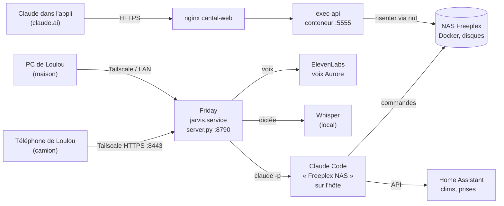

# De l'exec-api à Friday — l'histoire complète

> Rédigé le 27/10/2026 à partir de la mémoire Freeplex (MemPalace), de l'historique Git de ce dépôt et des fichiers du NAS.
> Aucun jeton, mot de passe ni clé n'apparaît ici : ils restent dans `~/.env`, `tokens.txt` et les fichiers cachés du NAS, hors dépôt.

## Sommaire

1. [Vue d'ensemble](#1-vue-densemble)
2. [Étape 1 — L'exec-api : donner des mains à Claude sur le NAS](#2-étape-1--lexec-api--donner-des-mains-à-claude-sur-le-nas-avant-mi-mai-2026)
3. [Étape 2 — Sécuriser l'accès](#3-étape-2--sécuriser-laccès-mai--août-2026)
4. [Étape 3 — La mémoire de Claude](#4-étape-3--la-mémoire-de-claude-mai--septembre-2026)
5. [Étape 4 — Claude Code installé sur le NAS](#5-étape-4--claude-code-installé-sur-le-nas-octobre-2026)
6. [Étape 5 — Le connecteur vocal « NAS vocal »](#6-étape-5--le-connecteur-vocal--nas-vocal--21102026)
7. [Étape 6 — Jarvis, le halo bleu](#7-étape-6--jarvis-le-halo-bleu-21102026)
8. [Étape 7 — La voix : de Piper à ElevenLabs](#8-étape-7--la-voix--de-piper-à-elevenlabs-2124102026)
9. [Étape 8 — Jarvis devient Friday](#9-étape-8--jarvis-devient-friday-21102026)
10. [Étape 9 — Les fonctions de Friday](#10-étape-9--les-fonctions-de-friday-2227102026)
11. [Où se trouve quoi](#11-où-se-trouve-quoi)
12. [Pièges connus](#12-pièges-connus)
13. [Coûts](#13-coûts)

---

## 1. Vue d'ensemble



Deux chemins mènent au NAS :

- **Le chat Claude (claude.ai / appli)** passe par l'**exec-api** : une petite API HTTPS qui exécute une commande sur le NAS et renvoie le résultat.
- **Friday** lance directement **Claude Code** sur le NAS (`claude -p`), qui a un vrai terminal.

---

## 2. Étape 1 — L'exec-api : donner des mains à Claude sur le NAS (avant mi-mai 2026)

**Le besoin** : Loulou est routier, absent toute la semaine. Il voulait que Claude administre le NAS à sa place, depuis n'importe où, sans PC ni Tailscale.

**Le principe** : un conteneur Docker `exec-api` (Python + Flask) qui reçoit une commande et l'exécute.

| Élément | Valeur |
|---|---|
| Adresse publique | `POST https://ton-domaine.example/exec` |
| Authentification | en-tête `X-Token` (jeton secret) |
| Corps | `{"cmd": "…"}` |
| Réponse | `{"stdout": "…", "stderr": "…", "returncode": N}` |
| Code | `docker/exec-api/app.py` + `Dockerfile` |
| Lancement | service `exec-api` de `docker-compose-perso.yml` |
| Port interne | `127.0.0.1:5555` (jamais exposé directement) |

**Comment une commande est exécutée** :

1. nginx (`cantal-web`) reçoit la requête HTTPS sur le domaine public et la transmet à `exec-api:5555`.
2. `app.py` vérifie le jeton (comparaison à temps constant, `hmac.compare_digest`).
3. La commande tourne en tant qu'utilisateur `loulou` (`runuser -l loulou -c …`), dans `/home/USER`.
4. Le conteneur voit `/home/USER` en écriture, `/mnt` en lecture seule et le socket Docker.
5. Pour agir sur l'hôte lui-même (montages, disques, systemd), on passe par le conteneur `nut`, qui a les droits nécessaires : `docker exec nut nsenter -t 1 -m -u -n -i <commande>`.

L'image embarque les outils utiles à l'administration : client Docker, `jq`, `sqlite3`, `smartmontools`, `nmap`, `git`, `iotop`, etc.

L'exec-api sert aussi deux routes de mémoire (`/memoire`, `/memoire-append`) pour les premières versions de la mémoire de Claude (voir étape 3).

> La date exacte de création n'est pas retrouvée : les archives commencent le 18/05/2026, et l'exec-api tournait déjà.

---

## 3. Étape 2 — Sécuriser l'accès (mai → août 2026)

L'exec-api donne un accès complet au NAS : c'est la porte la plus sensible de Freeplex. Elle a été durcie par étapes.

| Date | Changement |
|---|---|
| 18/05/2026 | Port `5555` lié à `127.0.0.1` uniquement : seul nginx peut la joindre. En-têtes de sécurité ajoutés sur nginx (`server_tokens off`, `X-Frame-Options`…). |
| 18/05/2026 | Tailscale installé sur le PC portable : accès SSH de secours au NAS par le réseau privé (`100.x.y.z`). |
| 29-30/05/2026 | Une mini exec-api sur le PC de Loulou sert de rebond. Elle permet de recréer celle du NAS sans couper l'accès. |
| 23/06/2026 | Tous les secrets sortis du code et rangés dans `~/.env`, hors dépôt. Premier instantané « propre » de ce dépôt Git. |
| (date non retrouvée) | Prison `fail2ban` dédiée (chaîne `DOCKER-USER`) + prison `recidive` contre les essais de jeton. |
| 24/08/2026 | `app.py` et `tokens.txt` montés en volume. Le fichier de jetons est **relu à chaque requête** : on peut changer ou révoquer un jeton à chaud, sans redémarrer. |
| 07/10/2026 | Nouveau jeton, l'ancien est révoqué. Le jeton n'est plus dans les préférences Claude : il se lit dans le connecteur Mémoire. |
| 20/10/2026 | Le journal d'audit note la longueur et les 4 premiers caractères de tout jeton refusé (401), pour repérer les essais. |
| 27/10/2026 | Délai maximum d'une commande porté de 60 s à 300 s (nginx : 310 s). Au-delà, la sortie partielle est renvoyée avec le code 124 au lieu d'une erreur 500. |

**Règle d'or** : ne jamais recréer `exec-api` depuis l'exec-api elle-même. Elle se couperait en plein milieu et l'accès serait perdu.

---

## 4. Étape 3 — La mémoire de Claude (mai → septembre 2026)

Sans mémoire, Claude repart de zéro à chaque conversation. Plusieurs couches ont été ajoutées :

1. **Fichiers mémoire** sur le NAS (`mémoire/memoire_noyau.md`, journal), servis par l'exec-api.
2. **`CLAUDE.md`** à la racine de ce dépôt : les règles et pièges du NAS pour Claude Code.
3. **MemPalace** (27/09/2026) : un vrai serveur de mémoire (conteneur `mempalace`, compose `docker-compose-mempalace.yml`, port 8765). Il est exposé en HTTPS sur un chemin secret, et nginx ajoute le jeton. Il est branché comme **connecteur « Mémoire »** dans l'appli Claude. Tous les historiques de conversation y ont été importés, avec les secrets masqués.
4. **Mémoire intégrée de claude.ai** pour les préférences de Loulou.

---

## 5. Étape 4 — Claude Code installé sur le NAS (octobre 2026)

| Date | Changement |
|---|---|
| 04/10/2026 | **Claude Code** installé sur l'hôte, session « **Freeplex NAS** ». Loulou la pilote depuis son téléphone (Remote Control), sans validation à chaque action. La clé API Anthropic du `.bashrc` est mise en commentaire : Claude Code utilise l'**abonnement Pro** au lieu de la facturation à l'usage. |
| 05/10/2026 | Conteneur `chrome` : Google Chrome + extension **Claude in Chrome**, pilotés par un second Claude Code (« **Freeplex Web** ») pour les tâches sur les sites web. Il ne tape jamais de mot de passe : Loulou se connecte lui-même aux sites. |

C'est ce Claude Code « Freeplex NAS » que Friday utilise comme cerveau.

---

## 6. Étape 5 — Le connecteur vocal « NAS vocal » (21/10/2026)

Le **mode vocal** de l'appli Claude n'a pas accès à l'outil exec-api. Un connecteur MCP a donc été créé (commit `aea54bb`) :

```
Claude (serveurs Anthropic)
  → https://ton-domaine.example/mcp-<secret>/mcp
  → nginx (liste blanche des IP Anthropic + ajout du jeton)
  → conteneur nas-vocal-mcp (:8768)
  → exec-api
```

- Compose `docker-compose-nas-vocal.yml`, code `docker/nas-vocal-mcp/server.py` (Python sans dépendance).
- **Interrupteur d'urgence** : `input_boolean.acces_nas_vocal` dans Home Assistant. Éteint = tout est refusé (403).
- Prison `fail2ban` « nasvocal » : 3 essais ratés par heure → bannissement 24 h.
- Journal des commandes : `docker/nas-vocal-mcp/data/commands.log`.

---

## 7. Étape 6 — Jarvis, le halo bleu (21/10/2026)

**La demande** : une seule interface pour parler à Freeplex NAS, avec un halo bleu animé et une voix qui répond. À utiliser surtout depuis le téléphone dans le camion, et sur l'écran du PC à la maison.

### Version 1 (13 h) — un témoin

- Conteneur `jarvis-halo` (port 8790) branché sur les **hooks** de Claude Code (`UserPromptSubmit`, `PreToolUse`, `Stop`…).
- Le halo montrait ce que faisait Claude Code et lisait ses réponses avec **Piper** (voix locale gratuite).
- Limite : il ne faisait que regarder, on ne pouvait pas lui parler.

### Version 2 (13 h 40) — une vraie interface

- Le conteneur est remplacé par un **service systemd** sur l'hôte : `jarvis.service` (utilisateur `loulou`, `python3 -I /home/USER/jarvis/server.py`, redémarrage automatique).
- **Fonctionnement d'une question** (`POST /api/ask`) :
  ```
  claude -p "<question>" --output-format stream-json --verbose \
         --permission-mode bypassPermissions \
         --append-system-prompt "<consignes.txt>" \
         --resume <session_id>
  ```
  Le serveur suit le travail en direct : le halo passe en « Je réfléchis », puis « Je travaille ». La conversation garde son fil grâce à `--resume`.
- Une seule question à la fois (409 si occupé), bouton **Arrêter**, délai maximum 20 min.
- Bouton **Nouvelle** : oublie la conversation et repart de zéro.
- **Dictée** : le micro de la page envoie le son à **Whisper** (local, `127.0.0.1:10300`). Il faut une page en HTTPS pour avoir le micro.
- Testé en vrai : « Quelle température il fait dans le salon ? » → Home Assistant lu → « 25 °C » à voix haute ; « Et chez PRENOM_C ? » → le fil est gardé.

### Accès HTTPS (14 h 08)

HTTPS activé dans la console Tailscale, puis `tailscale serve` → **`https://freeplex.taild96231.ts.net:8443`**. La page n'est accessible que depuis les appareils de Loulou sur Tailscale, et elle demande une clé d'accès.

### Réglages de l'interface (21 → 24/10)

- Halo **toujours en mouvement**, même au repos (respiration lumineuse ±12 %).
- **Mode « halo seul »** : aucun texte à l'écran, Loulou écoute les réponses.
- Icône Freeplex (logo « Freeplex by Lomax 196 »), installable comme une appli sur le téléphone.
- Sur le PC : fenêtre Friday dédiée, zone de saisie au clavier possible (`?clavier=1`).
- Halo non allégé, à la demande de Loulou (23/10).

---

## 8. Étape 7 — La voix : de Piper à ElevenLabs (21→24/10/2026)

| Date | Étape |
|---|---|
| 21/10 13 h | Voix **Piper** (gratuite, sur le NAS). Jugée mauvaise. |
| 21/10 15 h | Compte **ElevenLabs gratuit** (10 000 caractères par mois). Clé API « Freeplex » créée par Claude sur le téléphone. Limite : pas de voix françaises de la bibliothèque en gratuit. |
| 21/10 15 h 11 | **5 $ de crédits** ajoutés, rechargement automatique désactivé. Les voix françaises deviennent utilisables. |
| 21/10 | Panneau « Voix » dans la page : extraits, choix de la voix, quota restant. **Repli automatique sur Piper** si ElevenLabs échoue (quota, réseau). |
| 21/10 15 h 37 | **Phrases d'attente** pré-enregistrées (« Très bien, je regarde ça immédiatement. ») : Friday répond tout de suite, sans attendre la vraie réponse. |
| 21/10 15 h 47 | **Résumés vocaux de Claude** sur le téléphone : `jarvis/dire.py` synthétise le texte, l'envoie au téléphone par SSH (Termux) et le joue. Repli : notification vocale Android via Home Assistant. |
| 22/10 | Voix plus rapide, accélérée par ElevenLabs elle-même (« version 2 »), longs blancs raccourcis. **Alerte crédits** : vocal + Telegram sous 5 000 crédits restants (`veille-cyber/credits.py`, toutes les heures de 8 h à 21 h). |
| 24/10 | Abonnement **ElevenLabs Starter** (payé à l'année). Modèle `eleven_v4_turbo`. |
| 24/10 | Le résumé vocal sort **sur le PC** quand Loulou est devant (écran déverrouillé et clavier/souris touchés depuis moins de 5 min), sinon sur le téléphone. |
| 27/10 | Voix **Aurore**, la même pour Friday et pour les résumés de Claude : « c'est parfait ». |

Voix essayées avant : George, Paul, Léo, Marie-Alice, voix créées sur mesure (« Jarvis »).

---

## 9. Étape 8 — Jarvis devient Friday (21/10/2026)

Après le passage à une voix féminine, Jarvis est renommé **Friday** (comme FRIDAY dans Iron Man) : titre, nom d'appli, consignes (« tu t'appelles Friday, l'assistante de Loulou »). Les chemins techniques restent `/home/USER/jarvis` et `jarvis.service`.

---

## 10. Étape 9 — Les fonctions de Friday (22→27/10/2026)

| Date | Fonction |
|---|---|
| 21/10 | Pilotage de **Home Assistant** : température des pièces, 5 clims Daikin, prises… |
| 22/10 | Réveil par mot-clé commencé… puis **abandonné** le 24/10 (« trop chiant à mettre en place »). |
| 23/10 | **Envoi de fichiers** : bouton trombone, glisser-déposer, coller. Les fichiers vont dans `jarvis/recus/` (max 200 Mo) et Friday les lit. |
| 24/10 | Micro USB pour le PC. Pas de reconnaissance du locuteur : « si le son passe, cela ira ». |
| 24/10 | **Aiguilleur de modèle** : avant chaque question, un appel rapide à Haiku choisit le modèle (Haiku pour l'heure ou la température, Sonnet par défaut, Opus sur demande). Un fichier joint impose au moins Sonnet. Modèle de secours si le premier échoue. |
| 24/10 | **Rappels parlés** sur le téléphone (`outils/rappel.sh`). |
| 24/10 | Contrôle du **PC** : lancer une appli, régler le volume, faire une capture d'écran (`outils/pc.sh`, `outils/ecran.sh`). |
| 27/10 | **Quota Claude épuisé** : message traduit en français (« le quota Claude de la semaine est épuisé, il revient le … »). |
| 27/10 | Connecteurs réduits à l'utile (mémoire Freeplex, Gmail, agenda, Drive), car Friday usait trop vite le quota hebdomadaire. |
| 27/10 | Journal des **paiements en plusieurs fois** consultable. |

---

## 11. Où se trouve quoi

| Quoi | Où |
|---|---|
| exec-api | `docker/exec-api/` (app.py, Dockerfile), service dans `docker-compose-perso.yml` |
| Connecteur vocal | `docker/nas-vocal-mcp/`, `docker-compose-nas-vocal.yml` |
| Friday — serveur | `jarvis/server.py` (service `jarvis.service`) |
| Friday — page | `jarvis/index.html` |
| Friday — consignes | `jarvis/consignes.txt` |
| Friday — outils | `jarvis/outils/` (rappel, pc, ecran…) |
| Résumés vocaux | `jarvis/dire.py` |
| Voix choisie | `jarvis/voix.json` ; liste des voix `jarvis/voix-choix.json` |
| Phrases d'attente | `jarvis/attente/<voix>/NN.mp3` |
| Fichiers reçus | `jarvis/recus/` (non purgé automatiquement) |
| Journal de Friday | `journalctl -u jarvis` |
| Secrets | `~/.env`, `docker/exec-api/tokens.txt`, `jarvis/.key`, `jarvis/.elevenlabs`… — **jamais dans Git** |

---

## 12. Pièges connus

- **Ne jamais recréer `exec-api` depuis l'exec-api.** Passer par `docker exec nut nsenter -t 1 … setsid nohup …`.
- **Docker Hub est bloqué** : `docker compose up --build` d'exec-api échoue. Utiliser `--no-build` avec l'image existante.
- **Commandes longues** : les lancer en arrière-plan (`setsid nohup … > log &`) et lire le log.
- **`/mnt` est en lecture seule** depuis l'exec-api : écrire dans `/home/USER`.
- **Friday reste bloquée sur une vieille idée** : bouton **Nouvelle**. Une très longue session rend Haiku moins fiable.
- **Quota Claude hebdomadaire** : Friday utilise l'abonnement Pro de Loulou. Une fois le quota épuisé, elle ne répond plus jusqu'à la remise à zéro.
- **Téléphone** : si Termux ou Tailscale sont coupés sur le téléphone, les résumés vocaux passent par la voix Android de secours.

---

## 13. Coûts

Voir le détail : [couts.md](couts.md).

En résumé : **environ 26 € par mois** (Claude Pro ≈ 21 € + ElevenLabs Starter ≈ 5 €), plus 5 $ de crédits ElevenLabs payés une fois le 21/10/2026. Tout le reste est gratuit ou déjà en place (NAS, Freebox, Tailscale, Home Assistant, Whisper, Piper).
